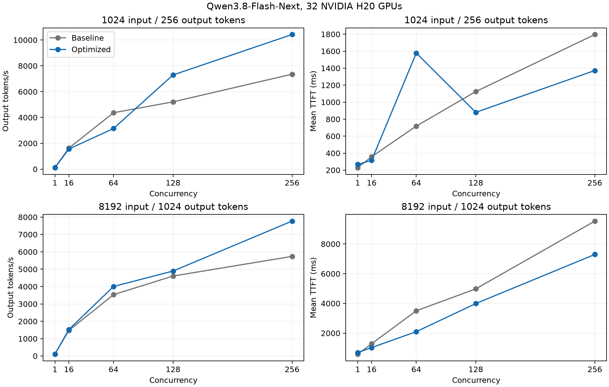

# Qwen3.8-Flash-Next on 32 H20 GPUs

Operational scripts for four 8-GPU nodes, with a fixed source and model revision:

This document records the completed first round. [Further optimization](round2/README.md)
is in progress, with separate candidate, failure and confirmation evidence.

- SGLang main: `a4a6eddd25343905245db7a8b54bcf24d9483c8b`
- Model: `Qwen/Qwen3.8-Flash-Next`, revision `de4b8e4d43b917e7706784d8bb445c9af86a3540`
- Baseline: BF16 weights and BF16 recurrent state, without speculative decoding.
- PyTorch 2.14.1 (CUDA 13.0), FlashInfer 0.7.2, SGLang kernel 0.4.10.

`packages-tested.txt` records the observed package versions, with local paths
and editable references removed. It is an environment record, not a resolver lock.

## Measured result

The deployed configuration uses eight TP4/EP4 replicas on four eight-H20 nodes,
with two replicas per node. It keeps BF16 weights and recurrent state, CPU PLE
embedding offload, the model's native 262,144-token context limit, FlashInfer GDN
prefill, Triton GDN decode, and the tuned Triton MoE configuration. Per-replica
settings are 64 running requests, decode CUDA graphs through batch 64,
8,192-token prefill chunks and static memory fraction 0.82. Interleaved SwiGLU
fusion and speculative decoding are disabled. The baseline uses four TP8/EP1
replicas and the default Triton GDN path.

At concurrency 256, output throughput across all 32 GPUs is:

| Input/output tokens | Requests per repetition | Baseline token/s | Optimized token/s | Change |
|---|---:|---:|---:|---:|
| 1024/256 | 2048 | 7,967.2 | 9,677.1 | +21.5% |
| 8192/1024 | 512 | 5,731.3 | 7,785.8 | +35.8% |

Values are medians of three repetitions. Observed throughput ranges were
7,927.3–7,998.0 and 9,572.0–10,106.5 token/s for the baseline and optimized short
workload; long-workload ranges were 5,261.6–5,750.8 and 7,771.0–7,805.9 token/s.
These are observed ranges, not confidence intervals. Median mean TTFT changed
from 1,115.2 to 994.9 ms for short requests and 12,531.8 to 6,342.4 ms for long
requests; median mean TPOT changed from 26.87 to 22.18 ms and 32.15 to 26.32 ms.
Short-request p99 TPOT increased from 35.10 to 36.01 ms.

Each configuration completed the same 19 measurements and 11,088 timed requests
with exact token counts and no failed requests. The optimized deployment also
passed 24 deterministic short chat checks, 24 retrieval checks at 8,049 input
tokens, and a final routed OpenAI chat check. All eight replicas passed final
health and process-identity checks, with zero captured runtime-error events or
retraction log lines. During the same 8K/concurrency-256 run, snapshots covering
all 32 H20 GPUs within 3.262 seconds showed at least 98% GPU utilization on each
GPU. NVML utilization measures device activity, not kernel efficiency.

The complete matrix includes regressions at lower concurrency: short requests at
concurrency 64 measured 3,143.7 versus 4,368.0 token/s. This deployment targets
high-concurrency throughput. The combined layout/backend/tuning change was
validated end to end; its total gain cannot be attributed to MoE tuning alone.
The equal-eight-GPU candidate measurements and the incomplete CUTLASS startup
attempt are retained in [screening.json](screening.json).

One node retained eight idle GPU contexts from the earlier shared-FUSE bytecode
stall, consuming 4,418–4,658 MiB (about 4.3–4.5 GiB) per GPU. Both baseline and
optimized measurements used that condition. The tested memory fraction leaves
headroom, but this run does not establish capacity after a clean node restart or
validate requests at the full native context limit. Response checks cover basic
service behavior rather than a business quality evaluation.

- [Machine-readable comparison, repetitions and ranges](comparison.json)
- [Baseline aggregates](results/baseline32/aggregate.csv) and [per-request data](results/baseline32/requests.csv)
- [Optimized aggregates](results/optimized32/aggregate.csv) and [per-request data](results/optimized32/requests.csv)
- [Launch configuration](launch-tp4ep4-tuned.json), [preflight validation](preflight-validation.json), [postflight validation](postflight-validation.json), and [32-GPU activity evidence](gpu-evidence.json)
- [Vector plot](throughput-comparison.svg)



## Runtime layout

Set `QWEN38_PROJECT` to a persistent project directory. Copy these Python scripts
to `$QWEN38_PROJECT/scripts/`. The scripts expect an editable installation of the
pinned SGLang source in `$QWEN38_PROJECT/workdir/venv/` and the pinned model in
`$QWEN38_PROJECT/checkpoints/Qwen3.8-Flash-Next/`. Create `logs/` and `results/`.

`runtime.py` uses this cluster's existing CUDA 13 driver compatibility libraries
at `/opt/cudacompat13/usr/local/cuda-13.3/compat` and C++ runtime at
`/opt/conda/lib`. Adjust those paths for another machine. Use a Python runtime
compatible with the installed PyTorch wheel. The tested runtime is Python 3.12.

Apply `cuda130-constraints.txt` when installing the main branch dependencies:

```bash
uv pip install --python "$QWEN38_PROJECT/workdir/venv/bin/python" \
  --prerelease=allow -c cuda130-constraints.txt -r /path/to/sglang/python/pyproject.toml
SGLANG_BUILD_RUST_EXTS=none uv pip install \
  --python "$QWEN38_PROJECT/workdir/venv/bin/python" \
  --no-deps --no-build-isolation -e /path/to/sglang/python
uv pip install --python "$QWEN38_PROJECT/workdir/venv/bin/python" sglang-router==0.3.2
```

The CUDA compiler, CRT and NVVM need matching versions. Unconstrained dependency
resolution selected CUDA 13.4 tools alongside PyTorch's CUDA 13.0 headers; this
failed FlashInfer's compiler/header compatibility check. The constraints pin the
13.0 toolchain. `runtime.py` also exposes pip's `lib/` through the conventional
`lib64/` path and creates the unversioned `libcudart.so` linker name.

Python bytecode and JIT caches live on each node's local disk. A shared-FUSE
bytecode read blocked all eight scheduler ranks on one node during startup;
moving `PYTHONPYCACHEPREFIX` to local storage allowed TileLang to import normally.

## Start and compare

Run commands on nodes owned by the current allocation, using the cluster's native
allocation command interface. `manage_service.py` starts a detached process and
records its exact command, PID, process group, start time and log. Attempt names
are unique and cannot overwrite earlier process records.

```bash
python3 "$QWEN38_PROJECT/scripts/manage_service.py" start \
  --attempt baseline-node0 --tp 8 --ep 1 \
  --extra --model-loader-extra-config '{"enable_multithread_load":true}'
```

The baseline uses one TP8 replica per node (four replicas). Candidate layouts
cover FlashInfer prefill, expert parallelism, two TP4 replicas per node,
and native NEXTN/MTP. FlashInfer decode on H20 (SM90) requires FP32 recurrent
state; use `--ssm-dtype float32` for that candidate. The other candidates keep
BF16 state and Triton decode. GPU-resident PLE embeddings and kernel tuning
can be evaluated on the best layout where memory permits. Supply candidate flags
after `--extra`; command records preserve the resolved CLI inputs.

Screening uses equal eight-GPU budgets and the geometric mean of output
tokens/s for both shapes at concurrency 64. This corresponds to concurrency 256
when scaling four such cohorts to 32 GPUs. The final comparison repeats the
complete 32-GPU protocol. Additional screens cover native interleaved SwiGLU
fusion and the FlashInfer CUTLASS BF16 MoE backend.

The TP4/EP4 tuned candidate is fully specified in `launch-tp4ep4-tuned.json`.
Copy `moe-searches/plain/configs/` to
`$QWEN38_PROJECT/data/moe-tuned-plain-tp4ep4/configs/`, preserving the JSON
filename, and verify its recorded SHA256. On each allocated eight-GPU node:

```bash
export SGLANG_MOE_CONFIG_DIR="$QWEN38_PROJECT/data/moe-tuned-plain-tp4ep4"
export SGLANG_OPT_FUSE_SWIGLU_INTERLEAVED=0 MAX_JOBS=8
python3 "$QWEN38_PROJECT/scripts/manage_service.py" start \
  --attempt "tuned-${NODE_LABEL}-a" --tp 4 --ep 4 --base-gpu 0 --port 31000 \
  --max-running 64 --graph-bs 64 --mem-fraction 0.82 \
  --extra --model-loader-extra-config '{"enable_multithread_load":true}' \
  --linear-attn-prefill-backend flashinfer
python3 "$QWEN38_PROJECT/scripts/manage_service.py" start \
  --attempt "tuned-${NODE_LABEL}-b" --tp 4 --ep 4 --base-gpu 4 --port 31001 \
  --max-running 64 --graph-bs 64 --mem-fraction 0.82 \
  --extra --model-loader-extra-config '{"enable_multithread_load":true}' \
  --linear-attn-prefill-backend flashinfer
```

Use a unique `NODE_LABEL` per node and run. The final router must contain all
eight worker URLs, both ports on each node. Stop the screening routers before
the full comparison so their health checks do not add background requests.
The router helper assigns the Prometheus listener to API port minus 1,000
(29,000 for the final API, 29,001 for screening), with an explicit
`--prometheus-port` override. Separate API ports alone do not prevent a metrics
listener conflict between router processes on the same node.

```bash
python3 "$QWEN38_PROJECT/scripts/manage_router.py" start \
  --attempt baseline-router --workers http://WORKER0:31000 http://WORKER1:31000 \
  http://WORKER2:31000 http://WORKER3:31000
python3 "$QWEN38_PROJECT/scripts/start_benchmark.py" \
  --attempt baseline-matrix --url http://ROUTER:30000 \
  --workers http://WORKER0:31000 http://WORKER1:31000 \
  http://WORKER2:31000 http://WORKER3:31000
```

Wait for all workers to pass health and response checks before benchmarking.
`smoke_services.py` checks model discovery and three deterministic short answers
on each worker, and saves the actual responses and server information. These
checks establish basic service behavior; they are not a model quality evaluation.

## Measurement

The benchmark invokes the pinned main branch's `sglang.benchmark.serving` module
through the round-robin router. `prepare_benchmark.py` verifies the source SHA256
and generates a separate benchmark script with one timing change: stop the timer
immediately after all request tasks finish, before the post-run `/server_info`
query. The original benchmark remains untouched. First-round measurements used
unmodified engine source; follow-up attention-DP experiments use the empty-launch
guard documented in [round2/kernel-fix.json](round2/kernel-fix.json).
This removes metadata-query latency from the throughput denominator; the
unmodified upstream mode remains available with `--timing upstream`.
Comparisons must use the same timing mode on both configurations. Defaults:

- Exact 1024/256 and 8192/1024 input/output token lengths.
- Concurrency 1, 16, 64, 128 and 256; unlimited arrival rate.
- `max(8, 2 * concurrency)` requests per point; fixed seed `20261031`.
- Native token-ID prompts, fixed length range, ignored EOS, no progress display.
- One untimed full-length warmup on every worker for each shape, then explicit
  cache flushes on every worker before each timed run. The benchmark's own
  warmup is disabled so no worker retains a warmup prefix in the timed run.
- Completed request count and total input/output tokens must match the workload.

Each run retains the exact command, timings, raw per-request metrics and logs in
`results/<attempt>/`. A manifest records completion or the first failure. Report
output tokens/s together with concurrency, TTFT and TPOT, and retain repeated
measurements for the chosen operating point. Synthetic random-token workloads
measure serving performance and do not represent an application quality test.
Timed requests use the native `/generate` endpoint with token IDs and fixed
output lengths; they do not apply a chat template. The separate chat response
checks use `enable_thinking=false`. Default thinking-enabled conversations are
a different workload.

Short requests also use a longer measurement window at concurrency 256:
`--shapes 1024:256 --concurrency 256 --prompt-multiplier 8 --repeats 3`.
Each repetition has 2,048 requests. Compare these repetitions separately from
the 512-request matrix points, and report the median and full observed range.

`run_stage.py` validates every worker with short and 8K-context prompts, verifies
the exact healthy router worker set before and after measurements, runs the full
matrix, then repeats the largest concurrency three times. The baseline and the
optimized deployment use this same workflow. `report.py` checks request and token
counts again and exports aggregate and per-request CSV files without deployment
addresses or generated text.

`phase2_sweep.py` runs bounded, equal-eight-GPU node-local sweeps and restores
the starting configuration. Plans may set `stage_peak_repeats: 0` and
`confirmation: {"repeats": 3, "prompt_multiplier": 8}` for longer confirmation:
the response checks and two initial 128-request matrix measurements run first,
then three 512-request repetitions of each shape. Apply the same plan to both
the control and candidate. Retain the initial measurements separately; fresh
processes showed substantial variation in their first short measurement.

`compare.py` requires the same complete 19-measurement protocol on both sides:
10 matrix points, six 512-request peak repetitions, and three 2,048-request
short repetitions. It checks 11,088 successful requests per configuration and
matching benchmark hashes, then compares the median of the three short steady
repetitions and the median of the three long peak repetitions. Its JSON includes
every primary repetition and observed min/max; these ranges are not confidence
intervals. `plot.py` plots the ten matrix points separately.

`profile_service.py` captures a separate six-step prefill/decode trace using
SGLang's native profiler API. Profiling requests are excluded from the serving
throughput measurements.

`start_tuning.py` runs the main branch's fused-MoE tuner on one otherwise idle
eight-GPU node, using the 74 configurations in `moe_search_space.json`. Install
Ray 2.55.1 and msgpack 1.2.4 without dependencies into `workdir/tuning_extra/`;
only the tuning process adds that directory to `PYTHONPATH`. Its Ray address is
`local`, with a unique temporary directory. The inference environment stays
unchanged. Publish a successful tuning result under
`$SGLANG_MOE_CONFIG_DIR/configs/triton_3_8_0/` and restart the candidate with that
environment variable. For EP configurations the microbenchmark's local expert
routing approximates the serving workload; accept a tuning change only after
an end-to-end serving comparison and response checks.

With `--fused-swiglu`, the helper creates a SHA-tagged derivative of the pinned
tuner that calls `fused_experts` directly with `fuse_swiglu_interleaved=True`.
The public `fused_moe` wrapper at this commit does not accept this argument.
Both source and derivative hashes are recorded; the tuning helper does not edit
engine files.
