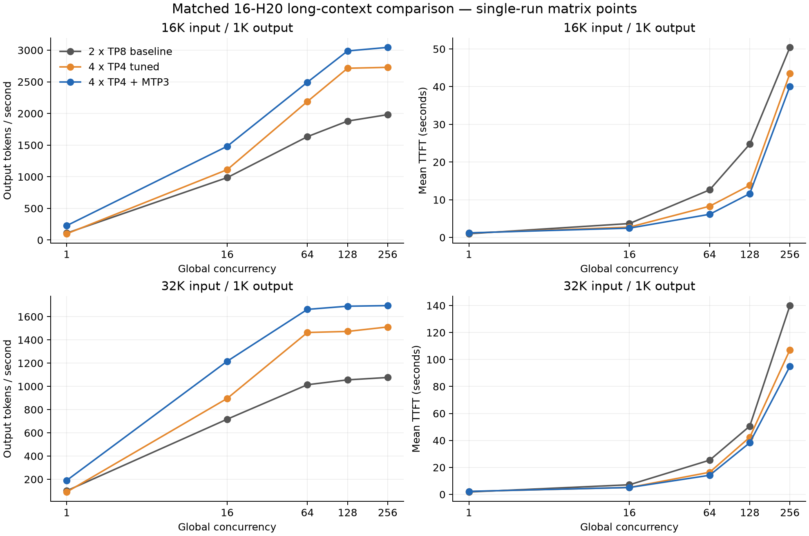

# Matched 16K and 32K throughput measurements

All three configurations used the same two eight-H20 nodes, pinned engine,
model, request timer and exact token-length protocol. The previous 32-H20 comparison was interrupted for a user-requested migration
to BJ80. Its results are separate from this fresh 16-H20 comparison. The previous
allocation was released before this comparison. This allocation was also
released after all measurements and exports completed.

The baseline uses two TP8/EP1 replicas, Triton linear attention, 8192-token
prefill chunks, per-replica running-request/decode-graph limits of 128, and
memory fraction 0.85. The tuned configuration uses four
TP4/EP4 replicas, FlashInfer linear-attention prefill, the original tuned Triton
MoE table, 8192-token chunks, BF16 weights/recurrent state and memory fraction
0.82, with running-request/decode-graph limits of 64. Its gain includes this
complete configuration change. MTP3 adds three
NEXTN steps, four verification tokens, top-k one and Triton verification to
the tuned configuration. Main executes NEXTN through its EAGLE path.

All replicas use CPU PLE embedding offload and node-local bytecode/JIT caches.
Those settings are common runtime provisions, with no separate gain attributed
to them in this comparison.

The primary results below are output token/s medians of three repetitions at
global concurrency 256, with 512 requests per repetition.

| Input/output | TP8 baseline | TP4 tuned | TP4 + MTP3 | TP4 vs baseline | MTP vs TP4 | Total vs baseline |
|---|---:|---:|---:|---:|---:|---:|
| 16384/1024 | 1982.3 | 2736.1 | 3055.2 | +38.0% | +11.7% | +54.1% |
| 32768/1024 | 1076.3 | 1510.6 | 1690.3 | +40.3% | +11.9% | +57.0% |

The latency table uses the median of each run's latency statistic across the
same three C256 repetitions; these are not pooled-request percentiles.

| Input | Configuration | Mean TTFT (s) | p99 TTFT (s) | Mean TPOT (ms) | p99 TPOT (ms) |
|---|---|---:|---:|---:|---:|
| 16K | 2 x TP8 baseline | 50.55 | 123.98 | 67.84 | 113.49 |
| 16K | 4 x TP4 tuned | 43.39 | 79.50 | 35.54 | 54.51 |
| 16K | 4 x TP4 + MTP3 | 40.05 | 74.25 | 35.70 | 69.22 |
| 32K | 2 x TP8 baseline | 140.00 | 235.74 | 63.21 | 109.19 |
| 32K | 4 x TP4 tuned | 107.22 | 167.07 | 31.65 | 49.92 |
| 32K | 4 x TP4 + MTP3 | 94.87 | 145.33 | 34.57 | 65.30 |

For 16K input, MTP increases the median mean TPOT by 0.5% relative to tuned TP4, despite higher output throughput. The configuration targets throughput; the latency statistics should also guide the operating concurrency.

For 32K input, MTP increases the median mean TPOT by 9.2% relative to tuned TP4, despite higher output throughput. The configuration targets throughput; the latency statistics should also guide the operating concurrency.

Effective concurrency capacity and the cumulative postflight acceptance snapshot:

| Configuration | Replicas | Configured requests per replica | Effective request slots by replica | KV token capacity by replica | Phase-wide mean accepted length by replica |
|---|---:|---:|---|---|---|
| 2 x TP8 baseline | 2 | 128 | 128, 128 | 2088512, 2088512 | —, — |
| 4 x TP4 tuned | 4 | 64 | 64, 64, 64, 64 | 706496, 706496, 706496, 706496 | —, —, —, — |
| 4 x TP4 + MTP3 | 4 | 64 | 55, 55, 55, 55 | 577856, 577856, 577856, 577856 | 3.684, 3.747, 3.788, 3.718 |

Acceptance lengths include the entire configuration phase, including untimed
checks and warmups. They are not per-shape rates. Effective running capacity
can be lower than the launch setting; excess global concurrency queues. Long
requests also consume the shared KV token budget, so request-slot capacity
does not establish simultaneous full-length context capacity.

Concurrency tradeoffs from the single-run matrix:

- 16K, 2 x TP8 baseline: C128 to C256 changes output throughput by +5.4%; mean TTFT changes from 24.76s to 50.42s.
- 16K, 4 x TP4 tuned: C128 to C256 changes output throughput by +0.5%; mean TTFT changes from 13.84s to 43.47s.
- 16K, 4 x TP4 + MTP3: C128 to C256 changes output throughput by +1.9%; mean TTFT changes from 11.63s to 40.07s.
- 32K, 2 x TP8 baseline: C128 to C256 changes output throughput by +1.9%; mean TTFT changes from 50.61s to 139.95s.
- 32K, 4 x TP4 tuned: C128 to C256 changes output throughput by +2.6%; mean TTFT changes from 42.37s to 107.14s.
- 32K, 4 x TP4 + MTP3: C128 to C256 changes output throughput by +0.3%; mean TTFT changes from 38.30s to 94.88s.

Lower-concurrency choices on the observed MTP curve:

| Input | Lowest measured MTP concurrency retaining ≥95% of C256 throughput | Output token/s | Fraction of C256 throughput | Mean TTFT (s) | C256 mean TTFT (s) |
|---|---:|---:|---:|---:|---:|
| 16K | 128 | 2987.8 | 98.2% | 11.63 | 40.07 |
| 32K | 64 | 1662.8 | 98.1% | 14.19 | 94.88 |

The 95% threshold is an explicit throughput/latency tradeoff for these
single-run matrix points. These lower-concurrency choices have not received
the separate three-repeat confirmation used for C256, and do not establish
an application latency SLO.

Each configuration completed 16 measurements and 4944 timed requests:
16384/1024 and 32768/1024 input/output tokens, concurrency 1, 16, 64, 128 and
256, then three additional C256 repetitions per shape. Requests use random
token IDs, seed 20261031, temperature zero and ignore-EOS with fixed output
length. Every worker is warmed for each shape, and every worker's prefix cache
is flushed before each timed run. The request timer excludes the final
server-info query. Individual requests and raw-file SHA256 values remain in
the CSV exports. Observed three-run ranges are not confidence intervals.

[Comparison and latency metrics](comparison.json), [validation and effective
capacity](validation.json), and [aggregate/per-request exports](results/) retain
the complete evidence. The plot below shows the single-run matrix points;
the primary table uses the separate longer repeated measurements.
Per-worker `avg_spec_accept_length` is a cumulative postflight snapshot across
the phase, not a per-shape acceptance rate or an independent throughput result.

Basic chat and approximately 16K/32K needle retrieval at positions 10%, 50% and
90% passed on each replica. These checks are not an application-quality
evaluation. The results apply to these fixed-length synthetic text requests;
they do not validate multimodal, shared-prefix, mixed-length or longer-output
workloads. The native 262144-token context limit is not a performance result.
Compiler data-race-warning counts are retained separately from runtime-error
and retraction log counts in validation.

The main base is `a4a6eddd25343905245db7a8b54bcf24d9483c8b`, plus the existing
empty-RMSNorm guard `fc2ad6c` and regression coverage `4b1c9d3`. No standalone
performance gain is attributed to that guard. The model revision is
`de4b8e4d43b917e7706784d8bb445c9af86a3540`. The request timer remains unchanged from the earlier pinned workflow.

For reproduction, use the pinned setup and MoE table in the parent directory,
and the corresponding launch layout in the second-round report. Run the
parent `run_stage.py` through a current owner allocation, with unique attempt
names, the full worker set, `--shapes 16384:1024 32768:1024`,
`--concurrency 1 16 64 128 256`, and `--peak-repeats 3`. Deployment addresses,
allocation IDs and session identities are excluded from this publication.
For log validation on this 16-GPU layout, start the parent
`record_longctx_runtime.py --project "$QWEN38_PROJECT" --gpus 16 --timeout 21600` alongside
the stages. It checks two baseline workers and four workers for each tuned phase.
For this run, the original collector checked TP4 and MTP, and a second collector
with `--gpus 16 --phase baseline` checked the final baseline after the original
collector's process identity was verified and stopped. Both executed collector
source hashes are retained in validation. The log-check patterns are identical.
