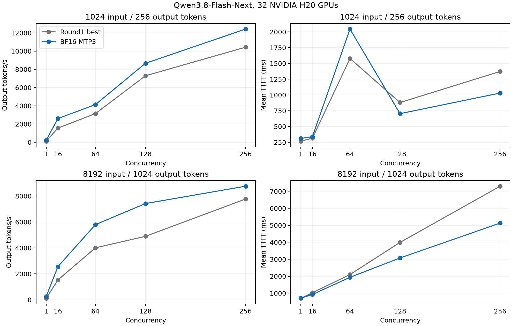

# Further optimization: completed 32-H20 MTP3 deployment

The first-round measurements remain documented in the parent directory. This
directory records the completed second-round screening and full 32 deployment.

The deployed layout is eight TP4/EP4 replicas on four eight-H20 nodes. It uses
three NEXTN steps, four verification tokens, BF16 weights and recurrent state,
FlashInfer prefill, Triton decode/verification, the original tuned MoE table,
8192-token prefill chunks, memory fraction 0.82 and round-robin routing.
Main normalizes NEXTN to its EAGLE execution path and loads the embedded Qwen
MTP weights. The pinned main base is
`a4a6eddd25343905245db7a8b54bcf24d9483c8b`, plus the empty-launch guard below;
the model revision remains `de4b8e4d43b917e7706784d8bb445c9af86a3540`.

The complete 32-H20 comparison used the same 19 measurements and 11088 timed
requests per configuration. At concurrency 256, the primary medians are:

| Input/output tokens | Round1 best output token/s | Final MTP3 output token/s | Versus round1 | Versus initial TP8 |
|---|---:|---:|---:|---:|
| 1024/256 | 9677.1 | 11768.0 | +21.6% | +47.7% |
| 8192/1024 | 7785.8 | 8879.3 | +14.0% | +54.9% |

Short medians use three 2048-request repetitions; long medians use three 512-request
repetitions. All samples, observed ranges and latency metrics are retained in
[comparison versus round1](comparison-vs-round1.json),
[comparison versus initial](comparison-vs-initial.json),
[aggregate CSV](results/mtp32/aggregate.csv) and
[per-request CSV](results/mtp32/requests.csv). Both sides use the same pinned
request timer, exact token lengths, seed, temperature 0, ignore-EOS policy,
per-worker warmup and cache flush before each timed run. Ranges are not
confidence intervals.

All ten matrix throughput points improved versus round1. Latency did not
improve uniformly: short C64 mean TTFT increased, and the long primary median
p99 TTFT increased from 14782.3 to 15419.0 ms (+4.3%). Against the initial TP8
matrix, short C64 throughput is still 5.45% lower. This is a throughput-priority
selection; the full curves and p99 metrics remain visible.



The plot shows the ten single-pass matrix points; the primary figures above
use the longer repeated runs. The [preflight](preflight-validation.json) and
[postflight](postflight-validation.json) record eight healthy, matching replicas,
24 successful short checks, 24 successful 8049-token retrieval checks, zero
runtime-error events and zero retraction log lines. Final routed model discovery
and deterministic chat also passed. These are basic response checks, not an
application-quality evaluation; the native 262144-token limit was retained but
only the stated workloads were validated.

During the same 8192/1024,C256 repetition, [GPU sampling](gpu-evidence.json)
observed all 32 GPUs at 100% NVML activity within a 0.94-second co-sampled window.
Native Spin was off, and all CUDA process sets matched preflight. This measures
GPU activity, not SM occupancy. One cohort retains eight pre-existing idle,
uninterruptible CUDA contexts occupying 4418–4658 MiB per GPU, as in round1.
Configured max-running is 64; effective capacity is 40 on that cohort and 55 on
the other cohorts. No GPU reset was performed.

Screening comparisons use equal eight-H20 budgets, concurrency 64, exact 1024/256 and
8192/1024 token lengths, and the same pinned engine, model and request timer as
the first round. Four same-node controls each have three repetitions per shape,
with 128 requests per repetition. Router-policy tests also have three
repetitions; initial service candidates have two, including their first run
after restart. Every successful timed request has checked token counts.

Fresh service processes show substantial variation in their first short run.
All samples are retained in the CSV files and
[screening-progress.json](screening-progress.json). Candidate selection uses
independent longer repetitions and a subsequent complete 32-GPU comparison.
The response checks cover basic chat and 8K retrieval, not application quality.

Independent longer confirmation on one unchanged eight-GPU cohort is complete
for the control, MTP3, and MTP3 plus 16K chunks. All use the empty-launch guard,
TP4/EP4, two replicas and the original MoE table. At concurrency 64, three
repetitions of
512 requests per shape gave these output-token/s medians:

| Configuration | 1024/256 | 8192/1024 |
|---|---:|---:|
| Original control, 8K chunks | 2496.3 | 1967.2 |
| NEXTN3 / four verification tokens, 8K chunks | 3078.7 | 2383.6 |
| NEXTN3 / four verification tokens, 16K chunks | 3017.9 | 2409.7 |
| Selected 8K MTP3 versus control | +23.3% | +21.2% |

All six longer measurements and both initial 128-request measurements are
retained for each configuration in [confirmation](confirmation/comparison.json).
These are eight-GPU confirmation results; the final 32-H20 results are reported above.
The 16K combination changed short/long throughput by -1.98%/+1.09% relative to
8K MTP3. Its equally weighted geometric mean was -0.45%, so 8K remains selected.
The [launch configuration](launch-tp4ep4-mtp3.json) records the validated 32-H20 deployment.

Results already established on the unchanged node-0 control layout:

| Router policy | Short output token/s | Long output token/s |
|---|---:|---:|
| Round robin control | 2607.31 | 1959.42 |
| Power of two | 2458.18 | 1828.07 |
| Cache aware | 2601.28 | 1946.63 |

Values are medians of three repetitions. Round robin remains selected for this
fixed-length throughput workload. The separate
[HC microbenchmark](hc-kernels.json) passed its numerical checks and supports
retaining main's existing split-kernel dispatch through batch 32; changing the
cutoff did not establish a useful improvement. Kernel timings are not serving
throughput results.

The [EP8 tuning result](moe-tp8ep8/provenance.json) uses main's official MoE tuner,
74 kernel configurations and eight batch sizes. It prepared the attention-DP
experiments; it does not by itself establish an end-to-end gain. Initial
controls and candidates used the unmodified main source. During the
attention-DP experiment, a zero-token grouped Gemma RMSNorm launch failed.
The fork now includes a host-side empty-launch guard in `fc2ad6c`, plus empty,
nonempty and CUDA-graph regression coverage in `4b1c9d3`. Confirmation and final
results record this patch explicitly; no upstream PR was opened.

Other completed screens cover 4K/16K prefill chunks, decode scheduling steps,
scheduler receive intervals, lazy Mamba cache checkpointing, prefill scheduling intervals,
maximum running batch 32, and FP32 FlashInfer MTP verification. None is selected
from the initial two-run screen. The longer MTP plus 16K chunk confirmation is
complete and does not improve the combined workload score. Patched attention
DP4 completed its initial screen, and DP4 plus
MTP completed three repetitions per shape; neither beat the selected TP4 MTP
layout on both workloads. Attention DP8 at memory fraction 0.82 ran out of memory
while capturing a prefill graph. Its 0.72 retry passed initial measurements but
lost five streams in a subsequent repetition; the root cause is not established.
Mixed prefill/decode passed single-request smoke checks but failed its
first concurrent run with a CUDA device assertion; its partial output is excluded
from the successful-results CSV files. Details are in
[failed-candidates.json](failed-candidates.json).

The existing NUMA binding was verified against the CPU affinity of both TP4
replicas and the GPU topology. No affinity change or NUMA performance gain is
claimed. The MTP confirmation retains BF16 recurrent state, three NEXTN steps,
four verification tokens and Triton verification. Five steps exceed the current
QSA verification-width limit; that startup failure is recorded separately.

The official MoE tuner also tested seven additional MTP-relevant token batches:
4, 96, 128, 160, 192, 256 and 16384. The new versioned table preserves all eight
original points. In the same-node three-repeat MTP3 comparison, the expanded
table changed short/long median throughput by -0.41%/+0.53%, or +0.06% for their
equally weighted geometric mean. This does not establish a consistent gain, so
the original table remains selected. Both tables, all six measurements per
configuration, and the decision are retained in
[moe-comparison](moe-comparison/comparison.json).

The complete bounded screening exports contain 124 successful measurements and
22784 timed requests across 24 CSV sets, separate from the final 32 protocol.
Failed startup and partial concurrent requests are documented separately and
excluded from successful-throughput comparisons. The empty-launch fix passed
33 GPU regression tests; no standalone performance gain is attributed to it.

To reproduce, use the parent directory's tested runtime setup, the pinned model
and main base plus the fork's guard/test commits. Install the original table
from `../moe-searches/plain/configs` under the project MoE root. From
`benchmark/qwen38_h20`, execute the following only through the current owner
allocation on each eight-GPU node, with `QWEN38_PROJECT` set to its persistent
project directory:

```bash
export SGLANG_MOE_CONFIG_DIR="$QWEN38_PROJECT/data/moe-tuned-plain-tp4ep4"
export SGLANG_OPT_FUSE_SWIGLU_INTERLEAVED=0
export MAX_JOBS=8
for i in 0 1; do
  python3 manage_service.py start --attempt "mtp-repro-$i" \
    --tp 4 --ep 4 --base-gpu "$((4*i))" --port "$((31000+i))" \
    --max-running 64 --graph-bs 64 --chunk-size 8192 \
    --mem-fraction 0.82 --ssm-dtype bfloat16 --extra \
    --model-loader-extra-config '{"enable_multithread_load":true}' \
    --linear-attn-prefill-backend flashinfer \
    --speculative-algorithm NEXTN --speculative-num-steps 3 \
    --speculative-num-draft-tokens 4 --speculative-eagle-topk 1 \
    --linear-attn-verify-backend triton
done
```

Use a round-robin router over all eight worker URLs and the same parent
`run_stage.py`, `start_benchmark.py`, `report.py` and `compare.py` protocol.
Use unique attempt names for new runs. Deployment addresses and resource-owner
identifiers remain in private operational records.
